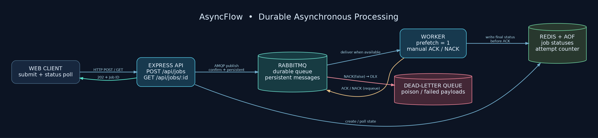

# AsyncFlow — Durable Asynchronous Job Processing

**Node.js · Express · RabbitMQ · Redis · Docker Compose**

AsyncFlow is a distributed-systems reference implementation that accepts a job over a synchronous REST API and processes it asynchronously in an independent worker. It demonstrates temporal decoupling, durable message buffering, consumer acknowledgments, bounded retries, dead-letter routing, persistent job status, and crash recovery.



## Architecture & data flow

1. The browser or API client submits a validated job using `POST /api/jobs`.
2. Express writes an initial `queued` record to Redis and publishes a **persistent message** to a **durable RabbitMQ queue** using a publisher-confirm channel.
3. The API returns `202 Accepted`, a UUIDv4 job ID, and the `/api/jobs/:id` status location **without waiting for job execution**.
4. An independent worker consumes from RabbitMQ with `prefetch(1)` and `noAck: false`, marks the record `processing`, and simulates four seconds of work.
5. The worker persists `completed` to Redis **before ACK**. Unacknowledged deliveries can be redelivered if the worker crashes.
6. A transient error is handled using NACK with requeue, while permanent failures are negatively acknowledged without requeue and flow to a Dead-Letter Exchange and Dead-Letter Queue.
7. The frontend polls REST status endpoints and displays queue depth, active consumers, completed work and dead-letter counts.

**Runtime topology:** `Browser → Express Producer → RabbitMQ Queue → Worker → Redis Status Store`. The producer also writes initial status to Redis; the browser polls status via the producer. RabbitMQ routes rejected poison messages to the DLQ.

### Delivery semantics

- **Broker durability:** durable queue, persistent messages, publisher confirms, and Docker volume.
- **Consumer recovery:** manual ACK after saved completion, with prefetch of one and Redis attempt tracking.
- **Idempotency:** completed job IDs are ignored on redelivery and immediately ACKed.
- **Retries:** simulated transient failure is requeued; simulated permanent failure is moved to the DLQ.
- **State persistence:** Redis append-only-file (AOF) with a persistent Docker volume.
- **Known limitation:** Redis creation + RabbitMQ publish is a cross-service dual write. Publisher confirms improve visibility but do not replace a transactional outbox in a production system.

## Getting started

### Prerequisites

- Docker Desktop with Docker Compose v2
- An available TCP port **3000** (app) and **15672** (RabbitMQ management)
- Node.js 20+ **only** for running tests on the host; the application itself runs in containers

### Start the entire architecture

```bash
docker compose up --build -d
docker compose ps
```

Open the **[AsyncFlow Dashboard](http://localhost:3000)** and the **[RabbitMQ Management UI](http://localhost:15672)**. Local management credentials are `labuser` / `labpass` by default; override through `.env` based on `.env.example`. These credentials are for local demonstration only.

Follow logs:

```bash
docker compose logs -f api worker
```

### REST API contract

| Method | Path | Success | Purpose |
|---|---|---|---|
| POST | `/api/jobs` | `202 Accepted` | Validate, create job ID, persist queued state, publish confirmed message |
| GET | `/api/jobs/:id` | `200 OK` | Get a job's lifecycle and attempt count |
| GET | `/api/jobs` | `200 OK` | List recent jobs |
| GET | `/api/metrics` | `200 OK` | Broker queue depth, consumer count, DLQ depth, recent outcomes |
| GET | `/api/health` | `200 OK` | Check broker + Redis dependencies |

Submit a job:

```bash
curl -i -X POST http://localhost:3000/api/jobs \
  -H 'Content-Type: application/json' \
  -d '{"name":"Generate report","kind":"normal"}'
```

Representative **response shape** (the actual UUID is generated at runtime):

```json
{
  "id": "<generated-job-uuid>",
  "status": "queued",
  "statusUrl": "/api/jobs/<generated-job-uuid>"
}
```

Poll using the returned real ID:

```bash
curl http://localhost:3000/api/jobs/REPLACE_WITH_RETURNED_ID
```

Supported `kind` values: `normal` (simulated ~4-second processing), `flaky` (first attempt NACK/requeue, second succeeds), and `poison` (permanent failure routes to DLQ). Job names must contain 3–80 characters.

## Observing RabbitMQ behavior

Inspect broker queue depth and unacknowledged deliveries:

```bash
docker compose exec rabbitmq rabbitmqctl list_queues name messages_ready messages_unacknowledged consumers
```

View the Redis job records:

```bash
docker compose exec redis redis-cli LRANGE asyncflow:recent 0 4
```

### Burst buffering

Use **Send five jobs** in the UI. The API publishes quickly, while the worker processes one job at a time because `prefetch(1)` is configured. RabbitMQ accumulates ready messages and drains as the worker ACKs deliveries.

### Worker isolation and recovery

```bash
docker compose stop worker
# Submit two jobs using the browser while the worker is stopped.
docker compose start worker
```

The API remains responsive while the consumer is offline; jobs stay in RabbitMQ and resume upon worker startup. To simulate a **hard crash while a job is processing**, submit a normal job, wait until the UI reports `processing`, and run:

```bash
docker compose kill worker
```

The Compose restart policy normally launches a new worker; RabbitMQ requeues the unacknowledged delivery. The job status may transition through `processing` more than once. If a job was already marked `completed` before the ACK was lost, the duplicate-completion guard ACKs it without processing again.

### Dead-letter behavior

Choose **Poison message** and submit. The worker sets `failed` in Redis and sends `NACK(requeue=false)` to RabbitMQ; the configured Dead-Letter Exchange routes it into `asyncflow.dead`.

## Quality assurance

Run pure, dependency-free unit tests:

```bash
npm test
```

Run the end-to-end suite against a **running local Docker stack**:

```bash
npm run test:integration
```

That standard run verifies HTTP 202 latency, status polling, burst processing, transient NACK retry, and poison DLQ isolation. For destructive worker lifecycle tests, run locally only:

```bash
RUN_DESTRUCTIVE_QA=1 npm run test:integration
```

**Note:** This test stops, starts and SIGKILLs the worker container. Do not run it against shared or production infrastructure. Each run saves actual measurements to `docs/qa-run-results.json` for inspection and evidence.

### Evidence status

| QA category | Current evidence | Required runtime proof |
|---|---|---|
| Input validation, UUID generation, outcome policy | **6 unit tests passed** in authoring environment | `npm test` output |
| Immediate `202 Accepted` and job status polling | Implemented; **not yet executed with Docker** | Network tab + integration test output |
| Five-job burst and queue buffering | Implemented; **not yet executed with Docker** | RabbitMQ management + logs |
| Worker offline / restarted, no lost queued work | Implemented; **not yet executed with Docker** | Worker stop/start + completed job states |
| Hard crash and unacknowledged message redelivery | Implemented; **not yet executed with Docker** | Worker SIGKILL + final attempt count |
| Poison message → DLQ and transient retry | Implemented; **not yet executed with Docker** | Queue metrics + `job_dead_lettered` and `job_nack_requeue` logs |

After running locally, use the **actual** generated results in [`docs/qa-run-results.json`](docs/qa-run-results.json), if present, rather than assuming the implementation passed integration QA. The test runner reports a failure if measured acceptance latency does not satisfy the assignment's 100 ms target.

## AI disclosure & audit

This project was developed using **ChatGPT (GPT-6)**. The exact user-provided course prompt is preserved in [`docs/assignment_prompt_original.md`](docs/assignment_prompt_original.md). A deliberately unsafe AI audit baseline, [`docs/ai-draft-unsafe.js`](docs/ai-draft-unsafe.js), demonstrates a fake in-memory queue and a blocking HTTP response. The production implementation corrects those mistakes with an external broker, publisher confirms, manual acknowledgment, and a persistent status store. The baseline is transparently identified as an **intentional audit artifact**, not an accidental bug found in deployed code.

The complete audit table, source prompt record, design limitations and code corrections are documented in **[`docs/AI_PROMPT_LOG.md`](docs/AI_PROMPT_LOG.md)**.

## Project structure

```text
.
├── src/
│   ├── server.js          # Express producer, status polling and queue metrics
│   ├── worker.js          # Independent RabbitMQ consumer, ACK / NACK / DLQ
│   ├── broker.js          # Durable topology and confirmed publishing
│   ├── store.js           # Redis job state and recent-history functions
│   ├── job.js             # Validation and job entity
│   ├── policy.js          # Retry / dead-letter decision logic
│   ├── config.js          # Service configuration
│   ├── uuid.js            # UUID input validation
│   └── logger.js          # Structured JSON logs
├── public/                # Dashboard UI (HTML, CSS, JavaScript)
├── diagrams/              # Self-authored architecture diagrams (PNG, SVG, Mermaid, DOT)
├── docs/                  # AI prompt record and QA evidence
├── scripts/               # Live integration/worker-crash QA runner
├── tests/                 # Dependency-free unit tests
├── Dockerfile
└── docker-compose.yml
```

## Shutdown / cleanup

```bash
docker compose down
```

Docker volumes preserve RabbitMQ and Redis data between runs. `docker compose down -v` **permanently removes the local demo's broker and status-store data**; do not use it if evidence must be retained.

## Reference documentation

- [RabbitMQ — Consumer Acknowledgments and Publisher Confirms](https://www.rabbitmq.com/docs/confirms)
- [RabbitMQ — Dead Letter Exchanges](https://www.rabbitmq.com/docs/dlx)
- [amqplib — Channel API](https://amqp-node.github.io/amqplib/channel_api.html)
- [Redis — Node.js client configuration](https://redis.io/docs/latest/develop/clients/connection-urls/)
